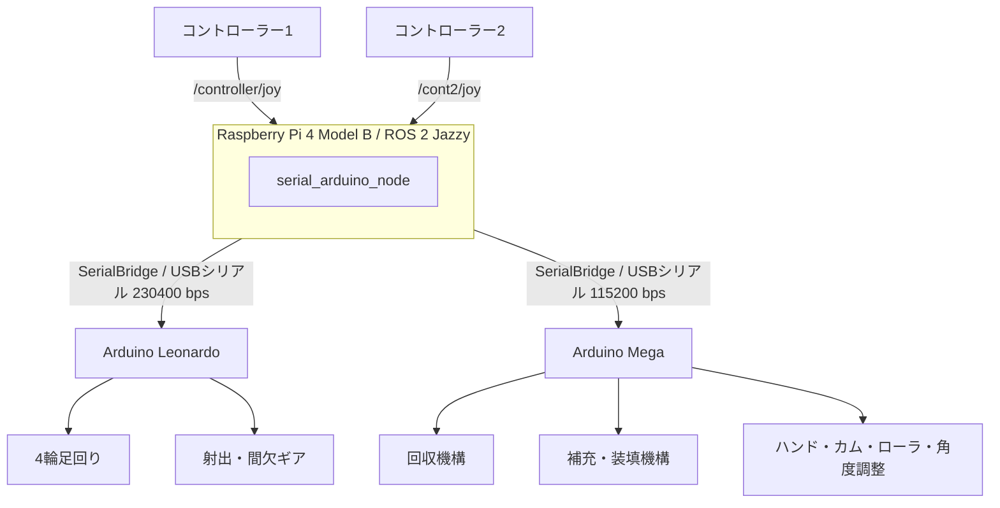
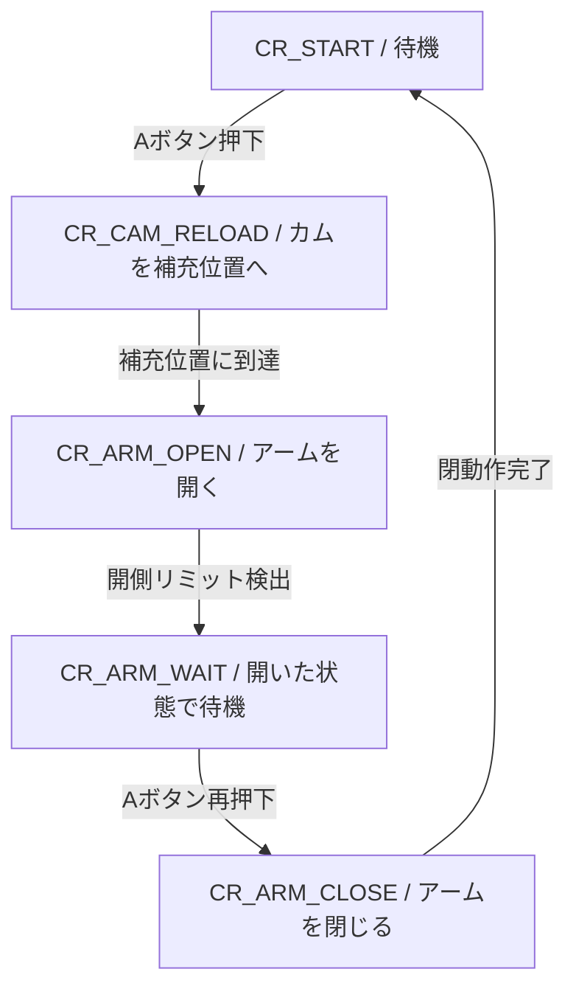

# 2026年度 ロボコンB ロボット制御プログラム

メカテック部で開発した、2026年度ロボコンBロボットの制御プログラムです。

本リポジトリには、Arduino Leonardo・Arduino Megaで動作するプログラムと、Raspberry Pi側で使用したプログラムの保存版が含まれています。

Raspberry PiではROS 2を使用し、2台のコントローラーから受け取った操作情報をSerialBridge経由で各Arduinoへ送信します。

**このREADMEは、2026年地区大会版（`1018地区大会/`）を基準としています。**

地区大会当時、全機構の正常動作を実機で確認しています。ただし、現在の環境における再ビルド・再動作まで保証するものではありません。

## 目次

1. [システム概要](#システム概要)
2. [使用機器・開発環境](#使用機器開発環境)
3. [リポジトリ構成](#リポジトリ構成)
4. [通信仕様](#通信仕様)
5. [コントローラー操作](#コントローラー操作)
6. [Arduino Leonardo](#arduino-leonardo)
7. [Arduino Mega](#arduino-mega)
8. [ピン配置](#ピン配置)
9. [電源構成](#電源構成)
10. [セットアップと起動](#セットアップと起動)
11. [安全上の注意](#安全上の注意)
12. [トラブルシューティング](#トラブルシューティング)
13. [地区大会後の改造版](#地区大会後の改造版)
14. [未確認事項](#未確認事項)

---

## システム概要

### 全体構成



### 各機器の役割

| 機器 | 主な役割 |
|---|---|
| Raspberry Pi 4 Model B | ROS 2、コントローラー入力処理、Arduinoとの通信 |
| Arduino Leonardo | 足回り、射出機構 |
| Arduino Mega | 補充・回収・装填・ローラ・角度調整機構 |
| MD13S | 各DCモータの駆動 |
| FEETECHサーボ | ハンド、装填カム、ローラ、角度調整 |

Raspberry Piはコントローラーの入力を処理して操作指令を送信します。各機構の状態管理やリミット検出などは、主にArduino側で実行します。

---

## 使用機器・開発環境

### 地区大会で使用した環境

| 項目 | 仕様 |
|---|---|
| Raspberry Pi | Raspberry Pi 4 Model B |
| OS | Ubuntu 24.04 |
| ROS 2 | Jazzy |
| マイコン | Arduino Leonardo、Arduino Mega |
| Arduino開発環境 | Arduino IDE |
| Pi・Arduino間通信 | SerialBridge |
| DCモータドライバ | MD13S |
| 足回りDCモータ | マブチモーター RS-555 × 4 |
| その他のDCモータ | マブチ製、定格7V、型番不明 |
| 主電源 | 4セルLiPoバッテリー |
| 制御機器の電源 | モバイルバッテリー |

将来的にRaspberry Pi 5を使用する可能性がありますが、本READMEの動作実績はPi 4を対象としています。Pi 5での動作は未検証です。

### 主な依存ライブラリ

- [SerialBridge](https://github.com/TNCT-Mechatech/SerialBridge)
- FEETECH SCServoライブラリ
- ROS 2 `rclcpp`
- ROS 2 `sensor_msgs`
- リポジトリ内の独自モータ・機構制御クラス

SerialBridgeとSCServoライブラリは、Arduinoへの書き込み時にも必要です。Arduino IDEから参照できるように導入してください。

ライブラリの厳密な使用コミット・バージョンは未確認です。

---

## リポジトリ構成

### Arduino側

```text
2026_B_Arduino/
├── README.md
├── 1018地区大会/
│   ├── 1004Pi.cpp
│   ├── 1006.cpp
│   ├── ros_leonardo/
│   │   ├── ros_leonardo.ino
│   │   ├── Motor.h / Motor.cpp
│   │   ├── Omni.h / Omni.cpp
│   │   └── TppSol.h / TppSol.cpp
│   └── ros_mega/
│       ├── ros_mega.ino
│       ├── Motor.h / Motor.cpp
│       ├── Collect.h / Collect.cpp
│       ├── Hand.h / Hand.cpp
│       ├── Reload.h / Reload.cpp
│       ├── Cam02.h / Cam02.cpp
│       ├── Roller.h / Roller.cpp
│       └── LookUp.h / LookUp.cpp
└── 地区大会後改造中/
    └── 地区大会後の変更作業用プログラム
```

### 主要ファイル

| ファイル | 内容 |
|---|---|
| [`1006.cpp`](1018地区大会/1006.cpp) | 地区大会で使用したPi側プログラムの保存版 |
| [`1004Pi.cpp`](1018地区大会/1004Pi.cpp) | Pi側プログラムの別バージョン |
| [`ros_leonardo.ino`](1018地区大会/ros_leonardo/ros_leonardo.ino) | Leonardoのメインプログラム |
| [`Omni.cpp`](1018地区大会/ros_leonardo/Omni.cpp) | 4輪足回りの制御 |
| [`TppSol.cpp`](1018地区大会/ros_leonardo/TppSol.cpp) | ソレノイドの制御 |
| [`ros_mega.ino`](1018地区大会/ros_mega/ros_mega.ino) | Megaのメインプログラム |
| [`Collect.cpp`](1018地区大会/ros_mega/Collect.cpp) | 回収機構 |
| [`Reload.cpp`](1018地区大会/ros_mega/Reload.cpp) | 補充アーム |
| [`Hand.cpp`](1018地区大会/ros_mega/Hand.cpp) | ハンド |
| [`Cam02.cpp`](1018地区大会/ros_mega/Cam02.cpp) | 装填カム |
| [`Roller.cpp`](1018地区大会/ros_mega/Roller.cpp) | ローラ |
| [`LookUp.cpp`](1018地区大会/ros_mega/LookUp.cpp) | 射出角度調整 |

### ROS 2側のリポジトリ

ROS 2側の実装は別リポジトリで管理しています。

[New_2026_B_Robocon_ros](https://github.com/TNCT-Mechatech/New_2026_B_Robocon_ros)

主な構成は次のとおりです。

```text
New_2026_B_Robocon_ros/
├── .gitmodules
├── SerialBridge/
└── src/
    ├── serial_arduino/
    │   ├── CMakeLists.txt
    │   ├── package.xml
    │   └── src/
    │       └── serial_arduino_node.cpp
    ├── ref_data_msg/
    │   └── msg/RefData.msg
    └── sensor_data_msg/
        └── msg/SensorDat.msg
```

地区大会で使用した `1018地区大会/1006.cpp` と、ROS 2リポジトリ内の `serial_arduino_node.cpp` は、提供された保存版において同一内容です。

README内では `serial_arduino_node.cpp` をROS 2側の正式な実装として説明します。

---

## 通信仕様

### 通信経路

| 通信先 | 通信速度 | 用途 |
|---|---:|---|
| Pi ↔ Leonardo | 230400 bps | 足回り・射出指令 |
| Pi ↔ Mega | 115200 bps | 補充・回収・各機構の指令 |
| Mega ↔ FEETECHサーボ | 1000000 bps | サーボ制御 |

PiとArduino間ではSerialBridgeを使用します。

ROS 2ノードは20ms周期のタイマーで通信処理を実行し、起動直後は約3秒間送信を待機します。

### Pi → Leonardo

構造体：`JoyData_t`

| メンバー | 型 | 内容 |
|---|---|---|
| `joyX` | `int16_t` | 左右移動 |
| `joyY` | `int16_t` | 前後移動 |
| `joyRot` | `int16_t` | 旋回 |
| `buttonGear` | `uint8_t` | 間欠ギア操作 |
| `buttonGearBack` | `uint8_t` | ギア戻し操作 |
| `buttonSol` | `uint8_t` | ソレノイド操作 |

データ本体は9バイトです。

Pi側の構造体には `__attribute__((packed))` が指定されています。送受信プログラムを変更する際は、メンバーの順序・型・サイズを両側で一致させてください。

### Pi → Mega

構造体：`MEGA_t`

| メンバー | 型 | 内容 |
|---|---|---|
| `buttonA` | `uint8_t` | 補充 |
| `buttonB` | `uint8_t` | 回収上昇 |
| `buttonX` | `uint8_t` | 回収下降 |
| `buttonCollectROT` | `uint8_t` | 回収回転 |
| `buttonCollectHand` | `uint8_t` | ハンド |
| `buttonCollectBack` | `uint8_t` | 回収回転戻し |
| `buttonCamUP` | `uint8_t` | 装填カム上昇 |
| `buttonCamDOWN` | `uint8_t` | 装填カム戻し |
| `buttonRollGo` | `uint8_t` | ローラ正転 |
| `buttonRollBack` | `uint8_t` | ローラ逆転 |
| `buttonLookUp` | `uint8_t` | 角度調整上昇 |
| `buttonLookDown` | `uint8_t` | 角度調整下降 |

データ本体は12バイトです。

### Arduino → Pi

| 通信方向 | 内容 |
|---|---|
| Leonardo → Pi | 地区大会版の返信構造体にデータメンバーなし |
| Mega → Pi | `buttonA`、`buttonB`、`buttonX` の3バイト |

Megaからの返信は、受信したボタン値を返すものです。機構の動作完了やセンサー状態を直接通知するデータではありません。

**注意：** 上記のバイト数は構造体のデータ本体を指します。SerialBridgeの通信フレーム全体の長さではありません。

### シリアルポート

地区大会版では、Pi側に次のパスが定義されています。

```cpp
#define SERIAL_PATH_1 "/dev/serial/by-path/platform-fd500000.pcie-pci-0000:01:00.0-usb-0:1.3:1.0"
#define SERIAL_PATH_2 "/dev/serial/by-path/platform-fd500000.pcie-pci-0000:01:00.0-usb-0:1.4:1.0"
```

- `SERIAL_PATH_1`：Leonardo
- `SERIAL_PATH_2`：Mega

これらは地区大会当時の接続環境に依存するパスです。別のRaspberry Pi、USBポート、USBハブを使用する場合は、実際のデバイスパスを確認して変更してください。

確認例：

```bash
ls -l /dev/serial/by-path/
```

---

## コントローラー操作

ROS 2では2台のコントローラーを使用します。

| コントローラー | 購読トピック |
|---|---|
| コントローラー1 | `/controller/joy` |
| コントローラー2 | `/cont2/joy` |

以下のボタン番号は、ROS 2の `sensor_msgs/msg/Joy` に格納される配列のインデックスです。コントローラー機種やJoy入力ノードの設定が変わる場合、物理ボタンとの対応も確認してください。

### コントローラー1

| 入力 | 配列インデックス | 動作 |
|---|---:|---|
| 左右移動 | `axes[0]` | 足回り左右移動 |
| 前後移動 | `axes[1]` | 足回り前後移動 |
| 旋回 | `axes[2]` | 足回り旋回 |
| A | `buttons[0]` | 補充 |
| B | `buttons[1]` | 回収機構上昇 |
| X | `buttons[2]` | 回収機構下降 |
| L1 | `buttons[4]` | 回収機構の回転戻し |
| R1 | `buttons[5]` | 回収機構回転 |
| S | `buttons[7]` | 回収ハンド |
| 十字キー上 | `buttons[11]` | 前後移動指令 |
| 十字キー下 | `buttons[12]` | 前後移動指令 |
| 十字キー左 | `buttons[13]` | 左右移動指令 |
| 十字キー右 | `buttons[14]` | 左右移動指令 |

#### 足回り入力の処理

- スティック入力を最大値 `255 × 0.8 = 204` に変換します。
- デッドゾーンは変換後の値で±20以内です。
- 十字キーの指令値は `204 × 0.7` を整数に変換した値です。
- スティックと十字キーが同時に入力された場合、移動・旋回指令を0にします。
- 足回りの計算・モータ出力はLeonardo側で行います。

### コントローラー2

| 入力 | 配列インデックス | 動作 |
|---|---:|---|
| `buttons[0]` | 0 | 間欠ギア |
| `buttons[1]` | 1 | ソレノイド |
| `buttons[3]` | 3 | ギア戻し |
| L1 | 4 | ローラ正転 |
| R1 | 5 | ローラ逆転 |
| 十字キー上 | 11 | 装填カム上昇 |
| 十字キー下 | 12 | 装填カム戻し |
| 十字キー左 | 13 | 射出角度上昇 |
| 十字キー右 | 14 | 射出角度下降 |

操作表はPi側の `joy1_callback()`、`joy2_callback()` に基づいています。

---

## Arduino Leonardo

Leonardoは足回りと射出機構を制御します。

### 関連ファイル

| ファイル | 役割 |
|---|---|
| `ros_leonardo.ino` | メイン処理・SerialBridge通信 |
| `Motor.h / Motor.cpp` | PWM・DIRによるDCモータ制御 |
| `Omni.h / Omni.cpp` | 4輪足回り制御 |
| `TppSol.h / TppSol.cpp` | ソレノイド制御 |

### メインループの処理

1. SerialBridgeを更新する。
2. 新しい操作データがあれば受信する。
3. 通信確認LEDを更新する。
4. 足回りの制御を更新する。
5. ソレノイドの制御を更新する。
6. 射出・間欠ギアの状態を更新する。

### 射出機構

間欠ギアにはホールセンサーを使用しています。

ソレノイドとギアは、メインプログラム内の状態管理によって制御します。ソレノイドはPUSH動作の時間管理を行い、ギアはホールセンサーの入力などに応じて動作状態を切り替えます。

詳細な状態遷移を変更する場合は、`ros_leonardo.ino` と `TppSol.cpp` を併せて確認してください。

---

## Arduino Mega

Megaは補充・回収・装填などの機構を制御します。

### 関連ファイル

| ファイル | 役割 |
|---|---|
| `ros_mega.ino` | メイン処理・通信・機構の統合 |
| `Motor.h / Motor.cpp` | DCモータ制御 |
| `Collect.h / Collect.cpp` | 回収機構 |
| `Hand.h / Hand.cpp` | ハンド |
| `Reload.h / Reload.cpp` | 補充アーム |
| `Cam02.h / Cam02.cpp` | 装填カム |
| `Roller.h / Roller.cpp` | ローラ |
| `LookUp.h / LookUp.cpp` | 射出角度調整 |

### 補充シーケンス

Aボタンの押下を検出すると、補充シーケンスが進行します。



Aボタンは押し続けた時間ではなく、押下の立ち上がりを検出して処理します。

装填カムの手動操作は、補充シーケンスの状態によって制限されます。

### 回収機構

回収機構では、DCモータ3台とリミットスイッチを使用します。

- 上昇・下降
- 回転
- 回転戻し
- ハンド開閉
- リミット検出
- リミット到達後の負荷抜き・復帰動作

各動作の停止条件は `Collect.cpp` に実装されています。

### サーボモータ

Megaの `Serial1` を使用し、通信速度1000000 bpsで制御します。

| 機構 | 型番 | ID |
|---|---|---:|
| ハンド | STS3215 | 21 |
| 装填カム | STS3215 | 25 |
| ローラ | STS3215 | 27 |
| 角度調整 | STS3046 | 23 |

サーボのIDは実機に設定された値と一致させる必要があります。

---

## ピン配置

以下は地区大会版のソースコード上の定義です。配線作業時には必ず実機と照合してください。

### Leonardo：DCモータ

| 用途 | PWM | DIR |
|---|---:|---:|
| 足回りモータ1 | 13 | 12 |
| 足回りモータ2 | 11 | 10 |
| 足回りモータ3 | 9 | 8 |
| 足回りモータ4 | 6 | 7 |
| 間欠ギア | 5 | 4 |
| ソレノイド | 3 | 2 |

### Leonardo：その他

| 用途 | ピン |
|---|---|
| 間欠ギアのホールセンサー | A0 |
| 起動確認LED | A3 |
| 受信確認LED | A4 |
| ソレノイド確認LED | A5 |

### Mega：DCモータ

| 用途 | PWM | DIR |
|---|---:|---:|
| 回収モータ3 | 9 | 8 |
| 回収モータ4 | 11 | 10 |
| 回収モータ5 | 7 | 6 |
| 補充アーム | 5 | 4 |

### Mega：リミットスイッチ

| 用途 | ピン |
|---|---|
| 回収 `limit_3` | 16 |
| 回収 `limit_4` | 17 |
| 回収 `limit_5` | 20 |
| 回収 `limit_6` | 21 |
| 回収 `limit_7` | A2 |
| 補充アーム開側 | 14 |
| 補充アーム閉側 | 15 |

### Mega：その他

| 用途 | 設定 |
|---|---|
| 装填カム | サーボID 25 |
| ローラ | サーボID 27 |
| 射出角度調整 | サーボID 23 |
| ハンド | サーボID 21 |
| サーボ通信 | Serial1 |
| 起動確認LED | A7 |
| 受信確認LED | A6 |

**注意：** Megaの20・21番ピンはI2Cでも使用されるピンです。本プログラムでは回収機構のリミット入力として定義されています。機能を追加する場合はピンの競合を確認してください。

---

## 電源構成

地区大会版では、駆動系と制御機器の電源を分けています。

```text
4セルLiPoバッテリー
    │
    ▼
駆動系主電源スイッチ
    │
    ▼
電源分配・DC-DCコンバータ
    ├── 約12V系 → MD13S → RS-555 × 4
    └── 7V系   → MD13S → その他のDCモータ

モバイルバッテリー
    ├── Raspberry Pi 4
    ├── Arduino Leonardo
    └── Arduino Mega
```

4セルLiPoの公称電圧は14.8V、満充電時は16.8Vです。

足回りのRS-555には約12V、その他の定格7V DCモータには降圧した7Vを供給しています。

すべてのDCモータにMD13Sを使用し、ArduinoからPWM・DIR信号で制御しています。

**この図は概念図です。** DC-DCコンバータの具体的な型番・台数、サーボへの給電経路、配線の詳細は未確認です。実際の配線図の代わりには使用しないでください。

---

## セットアップと起動

### 1. ROS 2リポジトリの取得

ROS 2側のリポジトリにはSerialBridgeがGitサブモジュールとして登録されています。

取得例：

```bash
git clone --recurse-submodules \
  https://github.com/TNCT-Mechatech/New_2026_B_Robocon_ros.git

cd New_2026_B_Robocon_ros
```

すでにcloneしている場合：

```bash
git submodule update --init --recursive
```

`SerialBridge/` が空のままだと、`serial_arduino` パッケージのビルドに必要なソースファイルが不足します。

### 2. ROS 2環境の準備

地区大会ではUbuntu 24.04とROS 2 Jazzyを使用しました。

ROS 2 Jazzyを導入した環境で、必要な依存パッケージを準備してください。

```bash
source /opt/ros/jazzy/setup.bash
```

### 3. ROS 2プログラムのビルド

ROS 2ワークスペースのルートで実行する標準的なビルド例です。

```bash
colcon build --symlink-install
source install/setup.bash
```

`serial_arduino` パッケージは、CMakeからSerialBridgeのソースファイルを直接参照しています。

以下のパッケージが含まれます。

| パッケージ | 内容 |
|---|---|
| `serial_arduino` | コントローラー入力・Arduino通信 |
| `ref_data_msg` | `RefData.msg` |
| `sensor_data_msg` | `SensorDat.msg` |

`RefData.msg` には `int32[] ref_dat`、`SensorDat.msg` には `int32[] enc_dat` が定義されています。

### 4. Arduinoへの書き込み

Arduino IDEを使用します。

Leonardo：

```text
1018地区大会/ros_leonardo/ros_leonardo.ino
```

Mega：

```text
1018地区大会/ros_mega/ros_mega.ino
```

それぞれのスケッチをArduino IDEで開き、対応するボードとポートを選択してください。

必要な外部ライブラリは、事前に導入する必要があります。

### 5. シリアルポートの確認

ArduinoをPiへ接続した後、ポートを確認します。

```bash
ls -l /dev/serial/by-path/
```

地区大会版の `SERIAL_PATH_1` と `SERIAL_PATH_2` が、接続したLeonardo・Megaを正しく指していることを確認してください。

### 6. 地区大会での起動順序

実際に使用した起動順序は次のとおりです。

1. Raspberry Piを起動する。
2. Raspberry PiとArduino Leonardo・Megaを接続する。
3. ROS 2プログラムを起動する。
4. コントローラーを接続する。

ROS 2プログラムの地区大会当時の正確な起動コマンドは未確認です。

CMakeに定義された実行ファイル名から、標準的な起動コマンドの候補は次のとおりです。

```bash
source /opt/ros/jazzy/setup.bash
source install/setup.bash
ros2 run serial_arduino serial_arduino_node
```

これはソースコードの構成に基づく実行例であり、地区大会で使用したコマンドを復元したものではありません。

コントローラー入力を配信するノードも別途必要です。`/controller/joy` と `/cont2/joy` に、想定した形式の `sensor_msgs/msg/Joy` が配信されていることを確認してください。

---

## 安全上の注意

### 駆動系の電源スイッチ

4セルLiPoから電源を分配・降圧する前段に、駆動系の主電源スイッチを設置しています。

このスイッチは駆動系の電源遮断に使用します。

Raspberry Pi・Arduinoは別のモバイルバッテリーから給電されているため、LiPo側のスイッチを切っても制御機器が停止するとは限りません。

### 通信が途絶えた場合

地区大会では、通信異常が発生した際は再起動して復旧していました。

ROS 2ノードには、コントローラーからの入力が一定時間途絶えた際に警告を表示する処理があります。

ただし、警告処理は最後に受信した操作値を必ず0にする仕組みではありません。

そのため、**通信断時にロボット全体が自動的に安全停止するとは想定しないでください。**

再起動や配線の確認を行う際は、先に駆動系を安全に停止してください。

### センサー

- 射出機構にはホールセンサーを使用します。
- 回収・補充機構にはリミットスイッチを使用します。
- リミット入力は主に `INPUT_PULLUP` で設定し、LOWを検出条件としています。

使用したホールセンサーの製品ページ：

https://www.switch-science.com/products/2774

リミットスイッチの型番は未確認です。

---

## トラブルシューティング

### Arduinoと通信できない

次の項目を確認してください。

1. ArduinoがPiに接続されているか。
2. `SERIAL_PATH_1` と `SERIAL_PATH_2` が正しいか。
3. LeonardoとMegaの接続先を取り違えていないか。
4. Arduino側に対応するスケッチを書き込んでいるか。
5. Pi側とArduino側で通信速度が一致しているか。
6. SerialBridgeの送受信データ構造体が一致しているか。

MegaのA6、LeonardoのA4は通信受信確認用LEDとして使用されています。

### ROS 2をビルドできない

SerialBridgeのサブモジュールを取得しているか確認してください。

```bash
git submodule status
```

必要に応じて次を実行します。

```bash
git submodule update --init --recursive
```

また、ROS 2 Jazzyの環境を読み込んでいることを確認してください。

### コントローラーの入力が反映されない

トピック名とJoyメッセージを確認してください。

```bash
ros2 topic list
ros2 topic echo /controller/joy
ros2 topic echo /cont2/joy
```

Pi側のプログラムでは、コントローラー1に3個以上のaxesと15個以上のbuttons、コントローラー2に15個以上のbuttonsを要求しています。

配列の要素数が不足している場合、操作入力の更新処理は行われません。

### 特定の機構だけ動かない

以下を確認してください。

- 対象機構の電源・配線・コネクタ
- MD13Sの接続
- リミットスイッチの状態
- サーボのID
- MegaのSerial1通信
- 該当する機構クラスの状態遷移

地区大会時点で全機構の正常動作を確認していますが、運用上の注意点として配線・コネクタの接触不良がありました。

---

## 地区大会後の改造版

`地区大会後改造中/` には、地区大会後の変更作業用プログラムが保存されています。

本READMEでは、これらを地区大会版の正式な実装として扱いません。

地区大会後の改造版には、モータ関連ファイルを `Motor_Pwm.h / Motor_Pwm.cpp` に変更する作業などが含まれています。一方で、旧ファイル名を参照する箇所が残っている可能性があるため、地区大会版と混在させないでください。

改造版を利用する場合は、以下を確認してください。

- `#include` と実際のファイル名が一致しているか。
- Pi側とArduino側の通信構造体が一致しているか。
- ピン配置が実機と一致しているか。
- 機構の状態遷移・停止条件が変更されていないか。

---

## 未確認事項

以下は、提供されたコードと地区大会時点の情報だけでは確定できなかった項目です。

| 項目 | 状況 |
|---|---|
| 地区大会当時のROS 2起動コマンド | 不明 |
| SerialBridgeの厳密な使用コミット | 未確認 |
| Arduino IDEの使用バージョン | 未確認 |
| SCServoライブラリの使用バージョン | 未確認 |
| RS-555以外のDCモータの型番 | 不明 |
| リミットスイッチの型番 | 不明 |
| DC-DCコンバータの型番・台数 | 未確認 |
| サーボ電源の詳細な配線 | 未確認 |
| Raspberry Pi 5での動作 | 未検証 |
| 通信断時の自動安全停止 | 実装済みとは確認できない |

未確認事項を更新する際は、推測ではなく、実機・配線図・動作試験・ソースコードのいずれかで確認してから記載してください。

---

## 開発・引き継ぎ時の注意

本プロジェクトは、Raspberry Pi、Leonardo、Megaの3つのプログラムが連携して動作します。

通信構造体、ボタン割り当て、ピン配置を変更した場合は、関連するプログラムをまとめて確認してください。

特に、Pi側だけで構造体を変更するとArduino側との通信に不整合が生じる可能性があります。

変更時には、地区大会版を比較用の基準として残し、改造版で動作確認を行ってください。
